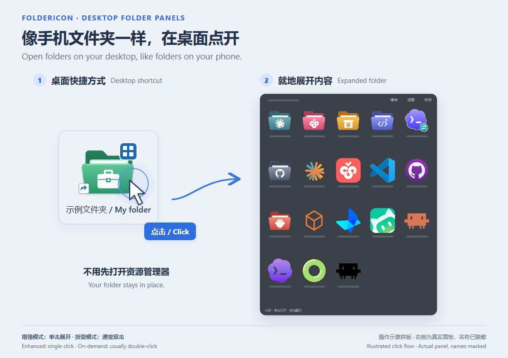
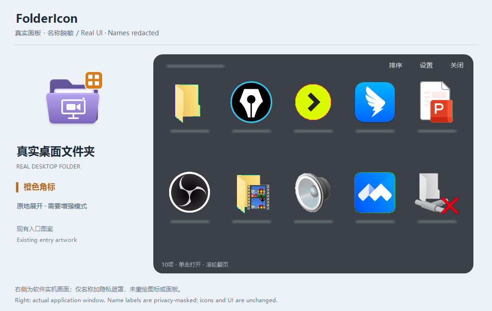
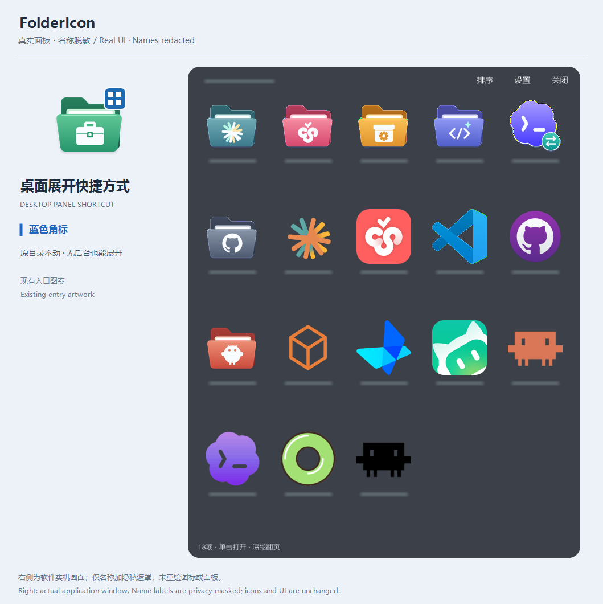
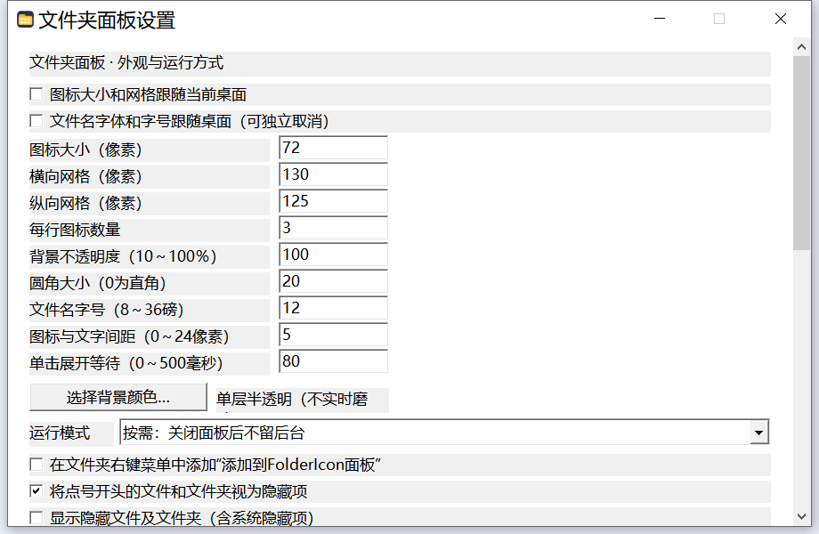
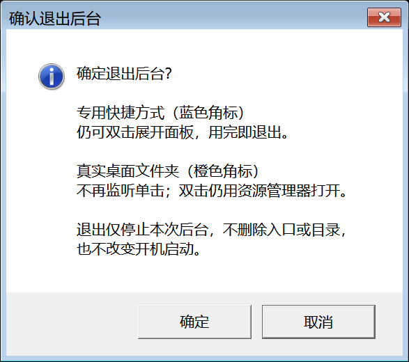

<div align="center">

# FolderIcon · Desktop Folder Panels

**Open desktop folders like folders on your phone. Keep everything in place.**

Native Win32 · Three entry tabs · Single-click opening · Monitor-aware windows

[简体中文](README.md) · [Downloads](https://github.com/yumumao/FolderIcon/releases) · [Release notes](docs/RELEASE-v2.0.0-rc.3.md) · [Validation](docs/VALIDATION.md)



</div>

FolderIcon opens frequently used folders as compact panels. Create a desktop launcher for a folder elsewhere, or enable panel expansion for an **existing real desktop folder without moving, replacing, or deleting it**.

This is an independent Chinese-language fork of [ltrudu/FolderIcon](https://github.com/ltrudu/FolderIcon), not an official upstream release. **v2.0.0-rc.3 is a public preview.** The application UI is currently Simplified Chinese; this document is an English usage guide, not an English UI announcement. Windows 10/11 x64 are the target platforms; hands-on testing has been on Windows 10. The README reuses reviewed click-flow, panel, settings and exit-confirmation illustrations, plus two owner-authorized, privacy-masked views of real folders. The hero reuses reviewed entry artwork and an actual panel; its desktop selection, pointer, and shortcut arrow are illustrative, not a full desktop capture. The actual panel is not redrawn. Demo settings paths are shortened for readability. Real-view titles and item names are masked; personal paths are not shown.

> **New in rc.3:** choose how each desktop item opens from its context menu; manage blue, orange and green entries in three tabs; use a centered green arrow badge; launch on mouse release without the double-click delay; and place new or reactivated windows on the icon's monitor. See [release notes](docs/RELEASE-v2.0.0-rc.3.md) and [desktop opening modes](docs/DESKTOP-MODES.md). Existing rc.1 and rc.2 tags and downloads are retained.

## Quick start

1. Download `FolderIconCN-v2.0.0-rc.3-win-x64.zip` from [Releases](https://github.com/yumumao/FolderIcon/releases) and extract it to a writable, permanent location. Do not run inside the ZIP.
2. Run `FolderIconCN.exe` to open settings. Opening settings does not automatically start a listener or register login startup or a context menu.
3. Open **管理桌面入口…** (Manage desktop entries). Use blue for folder launchers, orange for real desktop folders, or green for direct opening of desktop folders and shortcuts.
4. Add, remove, reapply badges or change opening modes in that window. Existing folders stay in place; generated blue launchers point to the original folders.
5. For desktop single-click actions and monitor following, click **启动后台** (Start background). Optionally enable and save **开机静默启动（内置启动项）** (Built-in silent login startup) separately.

> **Upgrading:** exit the listener, back up the whole application directory, and replace the EXE. Keep `FolderIcon.ini`, `icons/`, `folder-badges/`, `desktop-modes.ini`, `mode-backups/`, and sorting data. Do not relocate the EXE without updating its shortcuts. The release includes only an example INI, never someone's runtime configuration.

## Three kinds of desktop entry

| Type | Supported items | With the background listener | Removing the entry |
| --- | --- | --- | --- |
| Blue four-cell badge | New folder launchers or existing folder shortcuts | Single-click panel expansion | Deletes generated links or restores existing links; keeps the source folder |
| Orange four-cell badge | First-level real desktop folders | Single-click panel expansion in place | Restores the icon and default behavior; keeps the folder |
| Green arrow | First-level desktop folders and `.lnk` shortcuts | Opens on release; window follows the icon's monitor | Restores the icon and click behavior; keeps the item |

All badges share upper-right placement, rounded shape and white outline. They do not remove Windows' shortcut-arrow overlay or install a Shell overlay extension. Without the listener, generated blue launchers still open panels through normal Windows activation; ordinary shortcuts and real folders follow system behavior.

### Orange badge: expand an existing real desktop folder

This view pairs the existing folder's entry artwork with its actual FolderIcon panel. **Orange identifies a real folder that stays in place.** Desktop click interception requires the background listener; without a resident listener, Windows opens the folder normally.



### Blue badge: a desktop panel shortcut to a folder elsewhere

This view pairs a desktop panel shortcut with the actual contents of its real target folder. **Blue identifies a separate desktop launcher**, not a moved source directory. Normal Windows activation still opens its panel without a resident listener.



> Both views are owner-authorized. The left side previews the corresponding existing entry artwork; the right side captures the released application opening a real folder, not an AI-generated UI. Before capture, titles and folder, file, and shortcut names were replaced with irreversible blur-style privacy masks. Icons, badges, controls, and panel layout remain clear. These are the examples' existing icon choices, not artwork automatically applied to every installation.

### Entry settings and desktop location

Settings → **管理桌面入口…** opens three tabs with Add, Remove selected, Reapply badge and Change opening mode actions. Orange lists first-level real desktop folders; green accepts real folders and shortcuts. Application/file shortcuts cannot expand as panels.

- Management actions take effect immediately; closing the manager or canceling settings does not undo them. Removal explains its scope, and the three built-in blue entries remain available.
- Appearance, login startup and desktop location require Save and apply. The manager preserves unsaved appearance edits; save a changed desktop location before opening it.
- Windows' desktop location is detected automatically and can be overridden or reset. This changes FolderIcon's scope, not the Windows desktop or file locations, and does not intercept arbitrary Explorer windows.

The appearance screenshot below is retained from rc.2; rc.3 entry management uses the separate tabbed window described above.

## Expand selected subfolders inside the panel

Right-click a real subfolder in the panel and enable **在面板内展开** (Expand inside the panel). Configured subfolders get a visible badge; unconfigured folders continue to open in Explorer.


Use the prominent **返回** (Back) button or **double-click blank space inside a nested panel** to go back one level. The root panel does not navigate above its root. The folder context menu can disable nested expansion or open the folder in Explorer temporarily. Files and ordinary shortcuts still use their normal applications.

## Restore the blue badge after changing an icon

1. Change a managed shortcut's icon through its normal Windows Properties dialog.
2. Open FolderIcon settings and open **管理桌面入口… → 蓝色** and select that entry.
3. Click **重加角标** (Reapply blue badge) and confirm. No extra Save click is needed.

FolderIcon overlays the badge onto the shortcut's **current custom artwork**, writes an independent icon, and updates the shortcut. It does not revert your artwork, edit your original ICO, or alter the source folder's icon. ICO files and DLL/EXE icon resources are supported. Repeating the operation does not stack badges; unreadable custom icons produce an error rather than a silent fallback.

## Remove entries and clean up orphan badges

Deleting a generated desktop shortcut, either in settings or directly on the desktop, **never deletes the source folder**.

- The enhanced listener reacts to desktop-directory change notifications and reconciles entries after changes settle. It does not scan whole disks or repeatedly enumerate an idle desktop.
- Without the listener, opening settings performs reconciliation. **清理失效配置及孤立角标** runs it manually.
- Cleanup removes custom entries with no surviving managed shortcut, and restores unreferenced legacy folder badges for which this application owns recovery records. Explicit folder-expansion rules are not automatically deleted.
- Renamed shortcuts or surviving copies in the monitored desktop scope retain their entry. Offline directories, unreadable shortcuts, and incomplete enumerations are handled conservatively.
- Later user changes to a folder icon are not forcibly overwritten. Some generated ICOs are retained as recovery assets so copied shortcuts elsewhere do not lose their icons.

## Optional Explorer context menu

Settings → **管理桌面入口…** opens three tabs for blue panel shortcuts, orange desktop folders, and green direct-open entries. Add, remove, reapply badges and change modes there; changes take effect immediately.

Enable **FolderIcon打开方式…** for folders and shortcuts in settings. Right-click a first-level desktop folder or `.lnk` and choose:

- **展开面板**: expand a folder or a folder shortcut in place. Disabled for application and file shortcuts.
- **单击直接打开**: open the directory or launch the shortcut with its original arguments, working directory and show state. Adds a green arrow badge.
- **恢复默认**: remove this entry's override and restore its icon. Later external edits are protected; conflicts retain recovery files.

Single-click actions need the background listener. Green entries launch on release without waiting for the double-click interval. Rapid repeated clicks open once; the duplicate press/release is ignored. A normal press-and-drag, right-click and Ctrl/Shift selection keep their native behavior. Ordinary files, virtual icons and folders outside the desktop are excluded from direct opening; external folders still offer creation of a separate desktop panel shortcut. This is a per-user menu, not a resident Shell extension. Full Windows 11 interaction remains untested.

FolderIcon also places a green entry's newly opened or reactivated window on the monitor containing the clicked icon. Normal size and maximized/minimized state are retained; oversized windows are fitted to the destination work area. Placement happens once per launch. Third-party launchers, elevated windows, or windows that cannot be safely associated with the launch may retain their application-defined location. See [Desktop opening modes](docs/DESKTOP-MODES.md).

## Appearance, sorting, and interaction

Settings show the current background state, a separate login-startup checkbox, and a blue explanation card beside the appearance controls.



- Follow desktop icon/grid metrics and, independently, its font; or customize size, columns, and spacing.
- Configure color, opacity, and rounded corners. The current renderer uses a **single translucent layer, not live blur**, avoiding the former two-window corner problem.
- Right-click the panel and choose **排序与整理…** for per-folder sorting, direction, and custom arrangement. Drag rearrangement is supported.
- Dot-prefixed entries are hidden by default. Hidden/system items can be shown explicitly.
- Single-click an item to open it; use the wheel to page; press Esc or click outside to close.
- Settings enforce a minimum width and resize both columns and buttons proportionally. Scroll to the bottom for Save if the window is short.

### Background state and login startup

There is no on-demand/enhanced selector. The running listener is a state, not a stored mode.

| Action | Behavior |
| --- | --- |
| Run the EXE or `--settings` | Always opens settings, regardless of listener state |
| Start background button or `--resident` | Starts one shared listener; `--resident` stays silent and ignores the old mode gate |
| Exit background or `--stop` | Stops this session only; generated launchers still work on demand and real folders return to normal Windows behavior |
| Save the login startup checkbox | Manages only this application's Run entry, without starting or stopping the current listener |

An existing Startup-folder shortcut **does not need to change**: keep its EXE target and `--resident` argument. A manually added Startup shortcut and the built-in Run entry are separate startup sources; either one is sufficient. Turning off the built-in option does not delete manual shortcuts. Manage those in the Windows Startup folder if you want to disable all automatic startup.

Legacy `Resident` is used only as a login-startup fallback when `AutoStart` is absent. Saving writes `AutoStart` and mirrors the legacy key for old binaries. Neither value blocks an explicit background start. The tray offers settings and exit, not a mode switch. A highlighted notice beside the settings fields explains that dedicated shortcuts still open panels after exit, while real desktop folders are no longer monitored. Exiting through settings or the tray requires confirmation, with Cancel selected by default; login startup is unchanged.

The default panel preview delay is 80 ms. Green direct-open entries ignore that setting and do not wait for double-click recognition. Actual opening time still depends on system load, Shell and target startup.



## Lightweight, with measured limits

Native C++/Win32, without Electron, WebView, or the .NET runtime. Administrator privileges are not required. The rc.3 release EXE is 441,856 bytes, about 431.5 KiB; builds made with other toolchains may differ.

An earlier rc.1 Windows 10 idle-listener sample on October 12, 2026 (not a new rc.3 measurement) measured **14.24 MiB working set**, **3.89 MiB private memory**, and no measurable CPU-time increase over 15 seconds. This is **one short sample**, not a memory ceiling or a perpetual zero-CPU claim. See [validation and remaining coverage](docs/VALIDATION.md).

## Command line

```powershell
.\FolderIconCN.exe                           # Settings
.\FolderIconCN.exe --settings
.\FolderIconCN.exe --folder "$env:USERPROFILE\Documents"
.\FolderIconCN.exe --resident                # Start background silently, independent of saved preferences
.\FolderIconCN.exe --stop                    # Stop this session; keep saved startup setting
```

Generated launchers use `--entry <ID>`. The legacy `work`, `coding`, and `services` IDs remain supported. Settings manages new entries automatically; editing the INI is unnecessary. `--diagnose <output.json>` writes login-startup preference/desktop-metric diagnostics, not a file listing; keep diagnostics local unless reviewed.

## Build from source

Validated toolchain: Windows x64, PowerShell 7, and **Zig 0.13.0**. Install the compiler yourself; the local build script does not download it.

```powershell
.\scripts\build.ps1 -Zig 'zig' -BuildRoot '<build-directory>' -OutputDirectory '<output-directory>'
.\scripts\build.ps1 -Zig 'zig' -BuildRoot '<build-directory>' -TestsOnly
```

The script runs tests before building `FolderIconCN.exe`. Temporary files and Zig caches go into the build directory; personal INI/icon files are not overwritten. CMake also supplies the application and test targets, but that MSVC/CMake path has not been fully validated locally:

```powershell
cmake -S . -B build -A x64
cmake --build build --config Release
ctest --test-dir build -C Release --output-on-failure
```

`main.c`, the old `.sln`, and `.vcxproj` retain the upstream C implementation; **they do not build the current Chinese application**. The GitHub workflow runs the Chinese build/tests and uploads artifacts, rather than accidentally releasing the legacy C executable.

## Local data and uninstalling

`FolderIcon.ini`, generated icons, folder-badge recovery records, caches, and sorting data live beside the EXE. There is no built-in telemetry, account, online updater, or cloud sync.

To stop using the application: restore each managed opening mode, remove real-folder expansion rules, remove generated entries, and run badge cleanup; disable the context menu and built-in login startup, manage any manual Startup shortcuts, then exit the background listener. **Do not delete `folder-badges/` before restoring folder icons.** Resolve inaccessible folders or icon conflicts before removing recovery data.

## Scope and attribution

This preview does not claim complete Windows-version, multi-monitor/DPI, Explorer-restart, or concurrent-writer coverage. The EXE is unsigned: obtain it from this repository and verify the supplied SHA256; do not disable system security protections.

Upstream's README declares MIT, but its linked `LICENSE` file is missing from the checked tree. This fork preserves attribution and does not invent a replacement license. Verify the full permissions before redistribution or commercial use. See [upstream and license status](docs/UPSTREAM.md).

[Privacy and publishing](docs/PRIVACY.md) · [Validation](docs/VALIDATION.md) · [简体中文](README.md)
