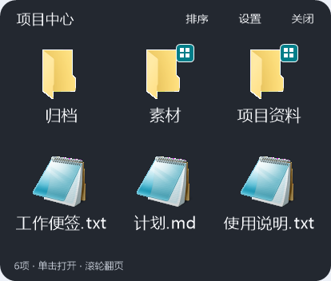
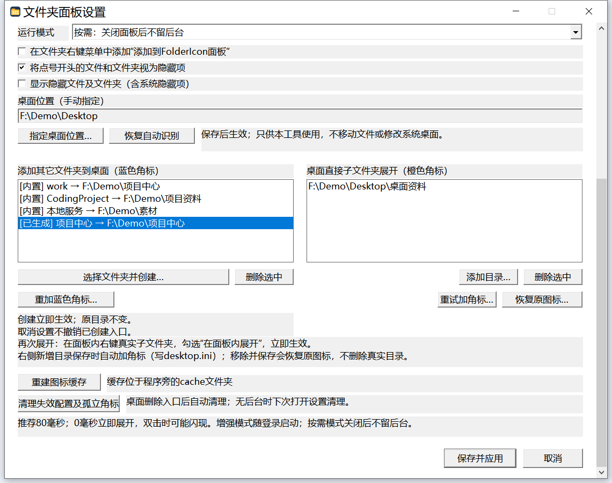

<div align="center">

# FolderIcon · 桌面文件夹面板

**文件夹留在原处，内容就在桌面展开。**

原生Win32 · 按需零常驻 · 可选单击展开 · 自定义图标角标

[English](README.en.md) · [下载与发布](https://github.com/yumumao/FolderIcon/releases) · [更新说明](docs/RELEASE-v2.0.0-rc.1.md) · [验证范围](docs/VALIDATION.md)



</div>

FolderIcon把常用文件夹变成轻量弹出面板。你可以给任意位置的文件夹创建桌面入口，也可以让**桌面已有的真实文件夹原地展开**，无需移动、替换或删除原目录。

本仓库是[ltrudu/FolderIcon](https://github.com/ltrudu/FolderIcon)的独立中文增强Fork，不是上游官方发行版。当前发布线为**v2.0.0-rc.1公开预览**；程序界面为简体中文，文档提供中英文。支持目标为Windows10/11 x64，目前实机验证环境为Windows10。配图来自合成演示目录，设置中的演示路径作了简化显示，不包含用户桌面文件。

## 一分钟开始

1. 从[Releases](https://github.com/yumumao/FolderIcon/releases)下载`FolderIconCN-v2.0.0-rc.1-win-x64.zip`，解压到一个可写、准备长期保留的位置。不要在压缩包内直接运行。
2. 打开`FolderIconCN.exe`进入设置。首次运行默认是**按需模式**，不自动添加后台和右键菜单。
3. 在左侧**添加其它文件夹到桌面（蓝色角标）**点击**选择文件夹并创建…**，选中目标文件夹并确认。
4. 桌面出现蓝色角标的展开快捷方式。按系统原有方式激活它（通常是双击），即可展开面板；关闭面板后进程退出。
5. 想用单击展开，或接管桌面已有的真实文件夹，请在设置里选择**增强：单击展开、双击打开**，再点**保存并应用**。

> 已经在用旧版？先退出监听，备份整个程序目录，再替换EXE。**不要覆盖已有`FolderIcon.ini`，也不要删除`icons/`、`folder-badges/`或排序文件来完成升级。** 保留程序位置，避免已生成快捷方式找不到EXE。发行包仅提供示例配置，不携带任何个人配置。

## 两种桌面入口，怎么选？

| | 蓝色角标：展开快捷方式 | 橙色角标：桌面真实文件夹 |
| --- | --- | --- |
| 适合 | 任意可访问位置的常用文件夹 | 已经放在桌面第一层的真实文件夹 |
| 会创建什么 | 一个桌面`.lnk`入口，原目录不动 | 不创建替身快捷方式，不移动原目录 |
| 无后台时 | 按系统点击方式打开面板 | 仍按Windows原有方式在资源管理器打开 |
| 增强模式时 | 单击展开；双击进入资源管理器 | 单击展开；双击进入资源管理器 |
| 移除后 | 删除本工具入口，不删除源目录 | 取消接管，安全恢复本工具添加的目录角标 |

两种角标使用相同的圆角四格风格，以颜色区分用途。**不会替换或全局关闭Windows的快捷方式小箭头。** 蓝色角标属于快捷方式的图像，不需要额外安装Shell图标覆盖扩展。

### 设置入口与桌面位置



- **左栏**可从其它磁盘或目录选择文件夹并创建桌面展开入口。
- **右栏**的添加目录窗口只列出当前桌面的**第一层真实文件夹**，不列快捷方式、文件或更深层目录。
- 桌面位置默认使用Windows实际桌面，而不是假定固定的用户目录。桌面迁移后识别不合适时，可点**指定桌面位置…**；也可**恢复自动识别**。
- 手动指定位置只改变FolderIcon自己的桌面范围，不迁移文件、不修改Windows桌面设置，也不代表软件会接管任意资源管理器窗口。
- 创建/删除蓝色入口、重加角标、清理属于**确认后立即生效**的操作；取消设置不会撤销。外观、运行模式、桌面位置及右侧列表修改需**保存并应用**。

## 文件夹里还能继续展开

对面板中的真实子文件夹右键，勾选**在面板内展开**即可。已设置的子文件夹显示角标；未设置的仍交给资源管理器，不会把所有目录自动接管。


- 子层级左上角有明显的**返回**按钮。
- 在子层级**双击面板空白处**也可返回上一级；根层不会越级跳出。
- 对子文件夹右键，可取消继续展开，或临时在资源管理器中打开。
- 文件和普通快捷方式依然交给其默认程序打开。

## 换了图标，蓝色角标怎么补回来？

1. 按Windows原有方式，在快捷方式属性里换成你喜欢的图标。
2. 打开FolderIcon设置，在**左侧列表选中这个已生成的入口**。
3. 点击**重加蓝色角标…**并确认，即刻生效。

软件会读取快捷方式**当前的图案**，生成一份独立的带角标图标，再更新快捷方式。不恢复成默认图案、不改动原始ICO，也不修改源文件夹图标。支持ICO及DLL/EXE图标资源；重复点击不叠加多层角标。若自定义图标无法读取，会报错，不会悄悄换成默认图标。

## 删除入口与自动清理

- 从设置删除已生成入口，或直接在桌面删除展开快捷方式，均**不删除真实源目录**。
- 增强后台利用目录变更通知，等待变更稳定后核对失效入口；空闲时不反复枚举目录，不扫描全盘。
- 没有后台时，下次打开设置也会核对。可随时点击**清理失效配置及孤立角标**手动执行。
- 只清理失去有效快捷方式的自选入口，以及本工具有恢复记录、又没有有效引用的历史目录角标；不会顺带删除你明确设置的文件夹展开规则。
- 改名或同一桌面范围内仍有有效副本时保留入口；目录离线、快捷方式不可读或枚举不完整时保守保留。
- 用户后来又改过目录图标时，不强行覆盖。部分生成的ICO会保留为恢复资产，避免其它位置复制的快捷方式断图标。

## 可选文件夹右键菜单

在设置中勾选**在文件夹右键菜单中添加“添加到FolderIcon面板”**，保存后使用。取消勾选再保存即可移除。

右键目标文件夹，选择**添加到FolderIcon面板**，先弹出操作选择对话框，再决定：

- **创建桌面展开快捷方式**：可用于桌面以外的文件夹。
- **让当前桌面真实文件夹展开**：仅适用于桌面第一层真实文件夹，保留原目录，不额外生成一个替身。

这是当前用户级菜单，不安装常驻Shell扩展。Windows11可能需要在传统的**显示更多选项**里寻找；该系统的完整交互尚未实机验收。

## 外观、排序与操作


- 图标与网格可以跟随桌面，字号也可独立跟随；也能手动设置大小、列数、间距。
- 支持背景颜色、不透明度、圆角。当前使用**单层半透明背景，不实时磨砂**，避免双层窗口导致圆角异常。
- **右键面板 → 排序与整理…**，设置当前文件夹的排序方式、方向与自定义排列；支持拖动整理。
- 点号开头的项目默认按隐藏项处理；可选择显示隐藏文件及系统隐藏项。
- 面板内单击项目打开；滚轮翻页；Esc或点击外部关闭。
- 设置窗口可拉宽，双列和按钮随宽度调整，并设最小宽度；窗口较矮时向下滚动可见保存按钮。

### 按需与增强模式

| 模式 | 进程行为 | 适合 |
| --- | --- | --- |
| 按需（默认） | 按需启动，关闭面板后退出 | 希望不保留后台的用户 |
| 增强 | 一个共用监听进程，登录后静默启动，不弹出设置 | 单击展开、桌面真实文件夹接管和实时清理 |

直接运行EXE是**打开设置**；增强模式登录自启使用`--resident`，两者并不冲突。保存按需模式会移除本工具的登录启动项并停止监听。托盘可打开设置、切回按需模式或仅退出本次监听。

默认单击预览等待80毫秒；不会缩短Windows自身的双击判定时间。实际速度仍会受系统负载及Shell图标提供程序影响。

## 轻量，但不夸大数字

原生C++/Win32实现，不使用Electron、WebView或.NET运行时；不要求管理员权限。当前已验证候选EXE约361KiB。

2026-10-12在Windows10上的一次后台空闲采样：工作集约**14.24MiB**、私有内存约**3.89MiB**；15秒内未测得CPU时间增长。**这是一次短时测量，不是内存上限或长期零CPU承诺。** 图标加载、面板打开及大目录会有不同开销。详见[验证范围](docs/VALIDATION.md)。

## 命令行

```powershell
.\FolderIconCN.exe                           # 打开设置
.\FolderIconCN.exe --settings                # 打开设置
.\FolderIconCN.exe --folder "$env:USERPROFILE\Documents"
.\FolderIconCN.exe --resident                # 已启用增强模式时静默监听
.\FolderIconCN.exe --stop                    # 仅停止本次监听，不删除自启
```

`--entry <ID>`用于生成的入口；保留兼容的`work`、`coding`、`services`三个内置ID。新增入口由设置自动管理，不需要手工编辑INI。`--diagnose <输出.json>`用于生成模式及桌面尺寸诊断，不列出文件内容；诊断文件仍建议只在本地保留。

## 从源码构建

已验证路径：Windows x64 + PowerShell7 + **Zig0.13.0**。编译器需自行安装，脚本不会自动下载依赖。

```powershell
.\scripts\build.ps1 -Zig 'zig' -BuildRoot '<构建目录>' -OutputDirectory '<成品目录>'
.\scripts\build.ps1 -Zig 'zig' -BuildRoot '<构建目录>' -TestsOnly
```

脚本运行测试后构建`FolderIconCN.exe`；构建目录承载TEMP/TMP与Zig缓存。不会覆盖个人INI和图标。CMake也提供`FolderIconCN`与测试目标，但MSVC/CMake路径尚未在本机完整验证：

```powershell
cmake -S . -B build -A x64
cmake --build build --config Release
ctest --test-dir build -C Release --output-on-failure
```

`main.c`、旧`.sln`与`.vcxproj`保留上游实现；它们**不是当前中文版的构建入口**。GitHub工作流改为调用上述中文版构建和测试脚本，上传工件，不自动将旧版C程序发布为中文版。

## 数据与退出使用

配置保存在EXE旁的`FolderIcon.ini`，图标、目录角标恢复记录、缓存和排序文件也存放于程序目录。软件不内置遥测、账号、联网更新或云同步。

如果不再使用：先在设置里取消真实文件夹展开规则、删除生成入口并清理孤立角标，再关闭右键菜单、切回按需模式，最后退出程序。**完成恢复前不要先删程序目录里的`folder-badges/`**。无法访问的目录或图标冲突应先处理完，再移除恢复数据。

## 已知边界与来源

- 当前为公开预览，不宣称所有Windows版本、多显示器/DPI、Explorer重启和极端并发场景已完整验收。
- 当前界面仅为简体中文；英文README不代表程序已提供英文界面。
- EXE未做代码签名；请从本仓库下载并核对随包SHA256，不建议关闭系统安全防护。
- 上游README声明MIT，但核对到的上游树缺少其链接的`LICENSE`文件。本Fork保留原作者归属，不补造许可文本；再分发或商业用途前请核实完整授权。详情见[来源与许可状态](docs/UPSTREAM.md)。

[隐私与发布规则](docs/PRIVACY.md) · [验证范围](docs/VALIDATION.md) · [English documentation](README.en.md)